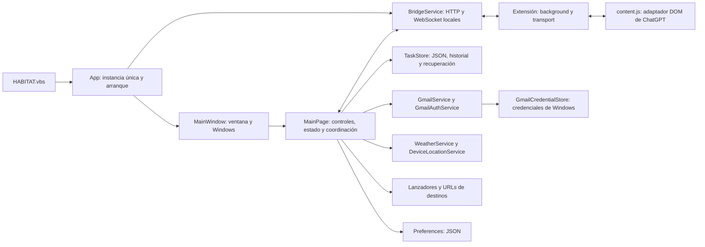

# Auditoría de arquitectura de HABITAT

Informe histórico previo a la implementación. Las correcciones y la arquitectura actual están descritas en [ARCHITECTURE.md](ARCHITECTURE.md). Los números de línea citados corresponden al estado auditado.

Fecha: 15 de octubre de 2026. Base de Git: `670c88a`, incluyendo los cambios locales existentes al iniciar la revisión.

**Conclusión:** la estructura es razonable para una aplicación pequeña de una sola ventana. Hay servicios con responsabilidades reconocibles y buenas defensas en tareas, Gmail y transporte. El mayor coste de mantenimiento está en la coordinación acumulada en `MainPage`, y las mejoras preventivas más útiles están en el aislamiento de pruebas y la distribución. Recomiendo una evolución gradual; una reescritura o una migración general a MVVM añadirían riesgo sin un beneficio inmediato demostrado.

Esta revisión no modifica código, configuración, interfaz ni comportamiento. No se ha cerrado, iniciado ni actualizado la aplicación del usuario. El único archivo de producto del repositorio añadido por la auditoría es este informe; las salidas de compilación y pruebas están en `artifacts/architecture-audit`. Los hallazgos de riesgo no equivalen a fallos observados en la aplicación en uso.

## Cómo está montada

- **Cliente:** C#, .NET 10 y WinUI 3, sin paquete, autocontenido. Un proyecto de aplicación; construcción de la interfaz principalmente desde C#.
- **Ventana:** `MainWindow` contiene el marco, la integración con Windows, el fondo y algunos eventos de ciclo de vida.
- **Pantalla:** `MainPage` construye controles, gestiona estados, preferencias, temporizadores, mensajes y los widgets. Sus cinco archivos de producción suman 2.308 líneas físicas; los dos archivos de comprobaciones condicionales añaden 454 líneas. Los `partial` ayudan a encontrar código, pero todos siguen formando una misma clase con acceso al mismo estado privado.
- **Integraciones:** servicios de Gmail, tiempo, ubicación, tareas y destinos externos; varios permiten sustituir HTTP o lanzadores en pruebas.
- **Chrome:** un worker MV3 mantiene el transporte; `content.js` adapta el DOM. Los mensajes de la aplicación pasan por el servidor local y la extensión, no por una API de modelos.
- **Entrega:** publicación x64 en `artifacts/win-x64`, inicio con VBS y aplicación de versiones preparadas mediante PowerShell.
- **Verificación:** seis ejecutables de comprobaciones .NET, una suite sintética de JavaScript y un modo de comprobaciones WinUI. Los proyectos .NET recompilan archivos fuente enlazados en lugar de referenciar una biblioteca compartida. La solución solo incluye la aplicación.

## Aspectos que conviene conservar

- `TaskStore` valida datos, usa exclusión entre procesos, detecta sesiones obsoletas, escribe mediante reemplazo y conserva revisiones verificadas. Sus pruebas cubren recuperación y fallos de escritura. Estas garantías son parte del contrato que debe mantener cualquier extracción.
- Gmail separa API, OAuth, almacenamiento de credenciales y análisis del correo. Usa PKCE, permiso de lectura, renovación serializada y cuerpos convertidos a texto; la API limita tamaño y concurrencia. El almacén de producción conserva la autorización duradera en Windows y evita persistir el access token en el vault.
- El puente distingue conectividad del socket y disponibilidad de la página; usa IDs, acknowledgements y un único mensaje en curso. Las pruebas verifican deduplicación, cambio de pestaña, reconexión y respuestas sintéticas.
- Los lanzadores tienen puntos de sustitución para comprobar argumentos y conservación de borradores sin abrir programas.
- La lógica pura de `TopWidgetLayout`, destinos y detección de contraste ya muestra una buena dirección: decisiones comprobables sin crear controles reales.

## Hallazgos y recomendaciones

Las prioridades expresan el orden preventivo recomendado. **Alta** significa abordar antes de ampliar automatizaciones o distribución; no indica una incidencia activa. **Media** identifica deuda que aumenta el riesgo de futuras modificaciones.

### A1. El modo de pruebas WinUI no aísla toda la infraestructura — Alta

**Evidencia:** `src/Habitat.App/App.xaml.cs:26` inyecta un `TaskStore` aislado y `Preferences` cambia su ruta con `HABITAT_UI_CHECKS`. Sin embargo, la construcción común de la página llama a `src/Habitat.App/MainPage.Gmail.cs:54`, que crea `GmailCredentialStore` sin ruta ni destino de prueba. El constructor de `GmailAuthService` ejecuta `store.Load()`. Además, `RecordGmailStartup` escribe un diagnóstico en el directorio de datos de escritorio.

**Implicación:** aunque no se inicie la sincronización, las pruebas de interfaz pueden leer la autorización real y, si existe un archivo antiguo pendiente de migración, intentar guardarla en el vault real. También pueden escribir fuera de los artefactos de prueba. No ejecuté estas pruebas WinUI durante la auditoría.

**Mejora:** inyectar una fábrica de servicios o un contexto de ejecución que sustituya credenciales, correo, ubicación, lanzadores y diagnósticos en modo de prueba. Aprovechar `IGmailCredentialStore`, que ya existe. Añadir una comprobación que falle si el modo de prueba intenta construir infraestructura real. No hace falta cambiar controles ni funciones visibles.

### A2. La actualización no es transaccional — Alta

**Evidencia:** `scripts/apply-staged-update.ps1:52` deduce si hay una respuesta en curso mediante expresiones sobre `MainWindowTitle`. Tras cerrar la aplicación, `scripts/apply-staged-update.ps1:65` sobrescribe el directorio instalado archivo a archivo. Solo se compara el hash de `HABITAT.dll`. El script de compilación habitual publica directamente en el directorio usado por el lanzador.

**Implicación:** un fallo de copia puede dejar una mezcla de versiones, sin restauración automática. La igualdad de una DLL no verifica los ejecutables, recursos y dependencias. La decisión de esperar una respuesta depende de textos de presentación.

**Mejora:** publicar siempre en un directorio independiente, verificar un manifiesto completo, conservar la versión anterior y activar la nueva únicamente al terminar la preparación. Obtener el estado ocupado desde un contrato de diagnóstico explícito, con su autenticación, en vez del título. Mantener el arranque desde la sesión normal de Windows. El diseño concreto del cambio de versión necesita pruebas de interrupción y rollback antes de instalarlo.

### A3. La puerta de verificación no ejecuta todas las suites — Media

**Evidencia:** `.githooks/pre-push:10` compila la solución, comprueba JavaScript y ejecuta las suites de extensión y puente. Omite Gmail, tareas, destinos y apariencia. Los proyectos de comprobaciones y la utilidad de Gmail tampoco forman parte de `Habitat.sln`. No hay configuración de CI versionada ni un comando común que reúna todas las comprobaciones.

**Implicación:** una subida puede pasar la validación existente aunque una de esas áreas haya dejado de funcionar. Recompilar archivos enlazados verifica lógica útil, pero no verifica por sí solo cómo se compone la aplicación de producción.

**Mejora:** crear un único script no visual de verificación que ejecute las siete suites y compile la app con salidas aisladas; usarlo desde el hook y, posteriormente, CI. Mantener las comprobaciones WinUI como paso específico, después de resolver A1. Incluir herramientas y tests en la solución o en una solución de verificación. Antes de futuras extracciones, añadir pruebas de caracterización de los estados que se van a mover.

### A4. `MainPage` reúne presentación y coordinación de funcionalidades — Media

**Evidencia:** `src/Habitat.App/MainPage.xaml.cs:59` mezcla construcción y suscripciones; `src/Habitat.App/MainPage.xaml.cs:362` coordina correo, tareas, tiempo, contraste y timeout del puente. La página consulta `Application.Current.MainWindow` repetidamente, y `src/Habitat.App/MainPage.xaml.cs:285` deduce estado de aplicación inspeccionando controles del historial. El archivo de tareas también calcula la distribución de Gmail y chat.

**Implicación:** modificar una función exige conocer estados de otras. La dependencia es circular en ejecución: la ventana construye la página y esta recupera la ventana globalmente. El estado funcional solo puede probarse en varios casos creando la UI.

**Mejora:** extraer pequeños coordinadores de conversación, Gmail, tareas y tiempo, con estado C# independiente de WinUI. Dejar el código de controles y su diseño donde está inicialmente. Pasar dependencias desde un punto de composición en `App`; introducir interfaces solo donde haya una frontera real o una necesidad de prueba. Separar archivos por sí solo no resuelve este acoplamiento. No recomiendo introducir ahora un contenedor de DI ni convertir toda la pantalla a MVVM.

### A5. La propiedad y el cierre de operaciones asíncronas están dispersos — Media

**Evidencia:** `src/Habitat.App/MainPage.xaml.cs:296` detiene el temporizador, cancela tiempo y desuscribe el puente. `src/Habitat.App/MainWindow.xaml.cs:248` guarda posición, detiene Gmail y espera el puente desde un manejador `async void`. `src/Habitat.App/MainPage.Gmail.cs:590` cancela y libera clientes sin esperar las tareas que los usan. Las actualizaciones periódicas se lanzan sin conservar sus `Task` para el cierre. `BridgeService.DisposeAsync` llama a `StopAsync` con timeout y después a `DisposeAsync`, sin un `finally` que garantice este último si falla la parada.

**Implicación:** es difícil demostrar que todas las operaciones terminan antes de liberar recursos o de completar el cierre. Los callbacks pendientes pueden sobrevivir al punto donde se consideran cerrados sus servicios. Es un riesgo inferido por inspección; no he reproducido un fallo de cierre.

**Mejora:** definir un propietario del ciclo de vida con `StopAsync` idempotente: impedir nuevos trabajos, cancelar, esperar las operaciones activas y liberar recursos en `finally`. Los eventos de WinUI pueden seguir siendo `async void`, delegando a tareas controladas y con manejo de errores. Probar cierre durante OAuth, refresco, envío y fallo de arranque con infraestructura sintética.

### A6. Las preferencias y las rutas de datos siguen políticas distintas — Media

**Evidencia:** `src/Habitat.Core/Services/Preferences.cs:41` escribe directamente con `File.WriteAllText` y descarta errores de acceso y E/S. `Load` vuelve a los valores predeterminados si el JSON no se puede leer. Las preferencias, tareas, credenciales y distintos logs resuelven sus directorios de forma independiente; tareas y Gmail incorporan protecciones específicas contra redirección de perfil.

**Implicación:** una interrupción durante el guardado puede perder preferencias y posición de ventana; un guardado fallido parece haber tenido éxito. Las diferencias al resolver rutas pueden volver a introducir problemas de perfil temporal en otra funcionalidad. Esto no implica que deban unificarse los mecanismos de protección de tareas y credenciales.

**Mejora:** centralizar la resolución de rutas y el contexto de producción/prueba, conservando exactamente las ubicaciones actuales y sus protecciones. Dar a preferencias escritura mediante temporal y reemplazo, y un resultado de guardado registrable. Mantener los mismos valores predeterminados y formato compatible. El diagnóstico puede ser interno; cualquier nuevo aviso visible quedaría fuera de una refactorización sin cambios de comportamiento.

### A7. El historial de tareas crece sin límite y se procesa en el hilo de UI — Media

**Evidencia:** `src/Habitat.Core/Services/TaskStore.cs:61` recorre las revisiones mediante `ReadHistory`; cada guardado prepara una copia completa y `WriteDurably` hace `Flush(true)`. No hay compactación ni límite de revisiones. `src/Habitat.App/MainPage.Tasks.cs:227` y `src/Habitat.App/MainPage.Tasks.cs:255` llaman al almacén sincrónicamente desde la página. El render reconstruye ambas listas completas.

**Implicación:** el trabajo de disco y reconstrucción crece con el historial y el número de tareas. Puede afectar al arranque y a la respuesta de la UI en listas grandes o discos lentos. No se ha medido una degradación en la lista del usuario, que no se ha leído.

**Mejora:** medir primero con historiales sintéticos grandes. Separar después la sesión de tareas de los controles y serializar la E/S fuera del hilo de UI. Estudiar un índice o compactación que preserve todas las tareas y su estado recuperable. No borrar revisiones automáticamente como simple limpieza: forman parte de la protección actual. No hay evidencia que justifique migrar ahora a una base de datos.

### A8. El contrato del puente está implícito y repartido — Media

**Evidencia:** `src/Habitat.Core/Models/BridgeModels.cs:1` representa eventos con cadenas y campos opcionales; `BridgeService`, `background.js`, `transport.js` y `content.js` comparten reglas sin un contrato versionado entre escritorio y extensión. Sí existe `protocol: 6` entre worker y página. Los plazos de recepción, disponibilidad y respuesta viven en componentes distintos. El servidor mantiene estados mediante varios campos y el reloj real.

**Implicación:** una modificación parcial puede introducir discrepancias de estados o compatibilidad. Probar expiraciones requiere esperas reales. Cambiar esta frontera a la vez que se reorganiza la pantalla aumentaría el riesgo.

**Mejora:** documentar los estados y mensajes actuales antes de cambiarlos, añadir fixtures compartidos de JSON y pruebas de transiciones inválidas, duplicadas y tardías. Extraer el estado del envío de los endpoints e inyectar `TimeProvider` para probar tiempos sin esperas. Estudiar negociación de versión como un paso posterior y explícito, conservando compatibilidad con la extensión instalada.

## Secuencia recomendada sin alterar la experiencia

| Paso | Resultado revisable | Riesgo y condición de avance |
| --- | --- | --- |
| 1 | Verificación común completa, fixtures de contratos e infraestructura de prueba aislada | Bajo; no tocar controles, etiquetas, plazos ni formatos de producción. |
| 2 | Punto de composición y extracción de un coordinador pequeño, empezando por estado puro | Bajo a medio; comparar estados y resultados con la implementación actual, una función por cambio. |
| 3 | Propietario único del cierre y operaciones en curso | Medio; probar cancelación y cierre antes de integrar. |
| 4 | Rutas centralizadas y guardado robusto de preferencias | Medio; mismos archivos, mismos valores y lectura de formatos anteriores. |
| 5 | Publicación preparada, verificación completa y recuperación de actualización | Medio; verificar fallos a mitad de instalación sin usar la instalación real. |
| 6 | Optimización del historial y de listas, solo si las mediciones la justifican | Medio a alto; conservar recuperación y estados. |

Una organización futura suficiente podría ser `Features/Conversation`, `Features/Gmail`, `Features/Tasks`, `Features/Weather`, `Features/Destinations`, junto con `Infrastructure` para almacenamiento, HTTP e integración con Windows. Empezaría dentro del mismo proyecto. Una biblioteca C# independiente puede introducirse después para los estados y reglas extraídos y ser referenciada por las pruebas, eliminando los enlaces de fuentes. No hace falta crear un proyecto por widget.

Mantendría expresamente el diseño y los controles existentes, textos de interfaz en inglés, accesibilidad, atajos, conservación de borradores, confirmación de Terminal, selección de conversación, tiempos de actualización, rutas de datos y autorización de Gmail. Las correcciones de resiliencia propuestas deben limitarse a situaciones de fallo y validarse por separado; ninguna refactorización es automáticamente libre de riesgo.

Dejaría para una necesidad demostrada la virtualización del historial de conversación, la reorganización general de estilos y plantillas, nuevos frameworks, nuevas dependencias y actualizaciones de versiones. Los ajustes de caret, botones y plantillas WinUI tienen compatibilidad específica y no deberían tocarse como limpieza rutinaria.

## Verificación realizada y límites

| Comprobación | Resultado |
| --- | --- |
| Compilación de `Habitat.App`, Release x64, `HabitatUiChecks=false`, salida independiente | Correcta; 0 errores y 0 advertencias. |
| `Habitat.Appearance.Checks` | Correcta. |
| `Habitat.Bridge.Checks` | Correcta; 12 comprobaciones con puerto local aleatorio. |
| `Habitat.Destination.Checks` | Correcta; lanzadores simulados y preferencias aisladas. |
| `Habitat.Gmail.Checks` | Correcta; 85 comprobaciones, cuentas y credenciales sintéticas. |
| `Habitat.Tasks.Checks` | Correcta; almacenamiento explícito bajo `artifacts/architecture-audit/Tasks`. |
| `Habitat.Weather.Checks` | Correcta; 17 comprobaciones, sin modo `--live`. |
| `tests/extension-background.checks.cjs` | Correcta; 43 comprobaciones con páginas sintéticas. |

Entorno de comprobación: SDK .NET `10.0.401` y Node.js `v24.13.0`. Se usaron las dependencias ya restauradas y compilación `--no-restore`. El sandbox bloqueó inicialmente las conexiones de bucle local de puente y OAuth; esas dos suites se ejecutaron después fuera del sandbox con sus datos sintéticos y terminaron correctamente. No fue un fallo demostrado del producto.

No se ejecutaron comprobaciones visuales, el modo WinUI de pruebas, llamadas reales a Google o Open-Meteo, actualizaciones de la instalación ni pruebas sobre el correo, conversaciones o tareas del usuario. Tampoco se midieron consumo de memoria, rendimiento de listas reales o comportamiento prolongado. Las suites satisfactorias respaldan los contratos que cubren; no certifican por sí solas ausencia de regresiones visuales ni todos los escenarios de integración.

La auditoría no incluyó una revisión de vulnerabilidades de dependencias ni una validación de compatibilidad contra todas las versiones de Windows. El endpoint de emparejamiento local y la automatización del DOM deben conservar un modelo de confianza documentado; no se presume que la clave local proteja frente a software malicioso que ya se ejecute con acceso equivalente en el equipo.
