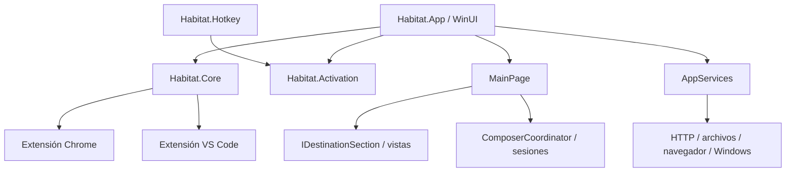

# Revisión general y deuda técnica — 6 de noviembre de 2026

## Diagnóstico original

HABITAT conserva una arquitectura razonable para una aplicación de escritorio: composición explícita, biblioteca compartida, sesiones comprobables, adaptadores identificables y defensas serias de persistencia y entrega. Conviene mantener esa base y continuar con extracciones pequeñas.

El crecimiento reciente está volviendo a concentrar decisiones en `MainPage`. También se acumulan implementaciones antiguas junto a sus sustitutas y flujos retirados junto al producto vigente. La deuda todavía se puede abordar por áreas, pero ampliar destinos sin consolidar estas fronteras aumentaría el coste de cada cambio.

Hay dos problemas prioritarios de entrega: la compilación aislada incorpora código de una salida anterior y el workflow no transmite la configuración integrada de Drive a la compilación del EXE. El primero se reprodujo; el segundo se deriva del workflow y de la evaluación del proyecto, sin inspeccionar un instalador publicado.

## Base y alcance

- Fuente declarada: **0.18.1**; Browser Bridge **0.10.9**; extensión VS Code **0.2.0**.
- Base Git: `599479914f441d8d992b0d83136f21d0631c995c`, rama `codex/release-0.18.1`.
- La revisión incluye **42 entradas locales previas** en `git status`, entre ellas la función de almacenamiento generado. Los hallazgos describen este árbol combinado y no certifican una release publicada.
- Inspección de proyectos, dependencias, composición, destinos, persistencia, concurrencia, actualizaciones, extensiones, scripts, workflows y documentación; ejecución de comprobaciones sintéticas.
- La evidencia local queda bajo `artifacts/architecture-audit-2026-11-06`. `source-snapshot.json` registra métricas y hashes de los archivos de código y configuración inspeccionados. Es evidencia local, no un artefacto distribuido con el repositorio.

## Estructura y aspectos que conviene conservar

Los cuatro proyectos de producción tienen referencias de proyecto en una dirección. `Core` reúne estado, reglas e infraestructura; su nombre no implica un dominio puro ni independencia completa de Windows. La composición manual actual es suficiente para este tamaño.

- [AppServices](../src/Habitat.App/Services/AppServices.cs) concentra la infraestructura y distingue explícitamente producción y pruebas aisladas.
- [ComposerCoordinator](../src/Habitat.Core/Features/Composer/ComposerCoordinator.cs), las sesiones y [AsyncOperationScope](../src/Habitat.Core/Services/AsyncOperationScope.cs) hacen comprobables decisiones de envío, revisiones de borradores, cancelación y drenaje.
- [TaskStore](../src/Habitat.Core/Services/Storage/TaskStore.cs), [ContactStore](../src/Habitat.Core/Features/Contacts/ContactStore.cs) y [AtomicFile](../src/Habitat.Core/Services/Storage/AtomicFile.cs) incorporan escrituras duraderas, exclusión, validación y recuperación. El historial es una garantía que debe preservarse al refactorizar.
- El puente y los adaptadores comprueban autenticación, identidad, correlación, resultados tardíos e incertidumbre de entrega. Las pruebas separan aceptación de una acción y confirmación de su resultado.
- La nueva limpieza comparte [un motor](../scripts/Habitat.GeneratedStorage.cs) entre app y PowerShell, verifica inventarios y protege versiones y operaciones. Sus 51 comprobaciones sintéticas pasan. Su complejidad aconseja mantener esa política común.
- Hay tres referencias NuGet directas en la app y ninguna en Core; Core utiliza el framework compartido ASP.NET. La mayor complejidad procede del producto y sus integraciones, no de una proliferación de frameworks.

Las métricas siguientes son líneas físicas con comentarios y espacios; orientan sobre concentración, no miden por sí solas complejidad o calidad.

| Área | Archivos | Líneas aproximadas |
| --- | ---: | ---: |
| App, producción, incluidos proyecto y XAML | 69 | 11.100 |
| Core, incluidos proyecto y recursos de código | 98 | 9.300 |
| Comprobaciones WinUI condicionales dentro de App | 35 | 5.500 |
| Código y proyectos bajo tests | 82 | 9.800 |
| JavaScript de Chrome | 17 | 2.450 |
| Scripts de desarrollo y distribución | 29 | 2.740 |
| MainPage de producción, subconjunto de App | 28 parciales | **5.255** |

El archivo compartido de almacenamiento está contabilizado en scripts aunque también se compile en Core. Las cifras no son cobertura de pruebas ni líneas ejecutadas.

## Hallazgos al iniciar la auditoría

### 1. P1 — La compilación aislada incorpora una copia antigua de código generado

**Reproducido.** [verify.ps1](../scripts/verify.ps1) cambia `BaseOutputPath` para proteger los binarios de uso diario. [Habitat.App.csproj](../src/Habitat.App/Habitat.App.csproj) copia `Habitat.GeneratedStorage.cs` como contenido bajo `updater`. Cuando existe una salida anterior en `src/Habitat.App/bin`, cambiar la base de salida deja esa carpeta antigua dentro del glob de compilación.

La evaluación MSBuild encontró **102 entradas Compile** con la salida predeterminada y **103** con la salida aislada: la adicional era `bin/x64/Release/net10.0-windows10.0.26100.0/win-x64/updater/Habitat.GeneratedStorage.cs`. La compilación ordinaria con salida aislada terminó con **38 advertencias y un error CS0117** porque esa copia antigua oculta el tipo de Core y carece de `ReadRegisteredRoot`.

Una importación temporal desde artifacts que solo retira `bin/**/*.cs` restauró las 102 entradas y permitió compilar toda la solución con **cero errores y cero advertencias**. Esa importación es diagnóstica: no corrige la configuración versionada del proyecto.

**Acción:** excluir explícitamente las salidas locales de los elementos de compilación con independencia de `BaseOutputPath`. Verificar tanto un checkout limpio como uno con una publicación previa. La compilación no debe depender de borrar archivos anteriores.

Evidencia: `compile-items-default.json`, `compile-items-isolated.json`, `compile-items-excluding-bin.json`, `build.normal.log` y `build.exclude-bin-target.log` dentro del directorio local de auditoría.

### 2. P1 — ZIP y EXE no reciben la misma configuración integrada de Drive

**Inferido del flujo de construcción.** [release.yml](../.github/workflows/release.yml) crea el archivo OAuth y establece `HabitatDriveOAuthClientFile` durante el empaquetado ZIP. Su bloque `finally` elimina el archivo y la variable. Un paso posterior llama a [build-installer.ps1](../scripts/build-installer.ps1), que vuelve a ejecutar `dotnet publish` para construir otro payload sin proporcionar esa propiedad.

El [proyecto de App](../src/Habitat.App/Habitat.App.csproj) incluye `Habitat.GoogleDriveOAuthClient.json` únicamente cuando la propiedad está definida. La evaluación del proyecto sin ella devuelve `EmbeddedResource: []`. En un perfil nuevo sin cliente previamente configurado, [CanConnect](../src/Habitat.Core/Features/Contacts/ContactDriveSync.cs) será falso y [la vista](../src/Habitat.App/Features/Preferences/ContactsPreferencesView.Manual.cs) deshabilitará **Connect Google Drive** y pedirá configuración.

**Acción:** construir ambos formatos desde el mismo payload verificado o compartir explícitamente la misma configuración entre ambas compilaciones. Comprobar el recurso y la capacidad de conexión en cada formato final, con un perfil sintético nuevo. Las pruebas actuales de existencia de archivos e instalación no comprueban esa capacidad.

Este hallazgo identifica un defecto del workflow vigente; no afirma que se haya inspeccionado el EXE publicado o la instalación personal del usuario.

### 3. P2 — MainPage vuelve a concentrar la coordinación del producto

Los 28 parciales de producción de [MainPage](../src/Habitat.App/MainPage.xaml.cs) suman 5.255 líneas, frente a las aproximadamente 2.650 registradas en la [auditoría anterior](ARCHITECTURE_AUDIT_2026-10-18.md). El tamaño es una señal; el problema es que todos comparten estado y decisiones privadas.

`Timer_Tick`, cada 250 ms, coordina actualizaciones, Gmail, contactos, Drive, tareas, mercados, programaciones y disponibilidad de envío. [MainPage.Composer](../src/Habitat.App/MainPage.Composer.cs), [ContactChannels](../src/Habitat.App/MainPage.ContactChannels.cs), [CodexSchedules](../src/Habitat.App/MainPage.CodexSchedules.cs) y preferencias mantienen conocimiento mutuo de estados, diálogos y servicios.

**Acción:** extraer primero la selección, el registro y el ciclo de vida de destinos de contacto; después la coordinación de programaciones y su disponibilidad. Mantener controles y foco en vistas propias y decisiones comprobables fuera de WinUI. Añadir archivos partial o un contenedor de dependencias no crea esa separación.

### 4. P2 — La puerta de verificación habitual omite el comportamiento de MainPage

[verify.ps1](../scripts/verify.ps1) y [verify.yml](../.github/workflows/verify.yml) ejecutan las diez suites de lógica y compilan App con `HabitatUiChecks=false`. Las 35 fuentes de comprobaciones nativas y sus aproximadamente 5.500 líneas tienen una ruta separada en [check-tasks-ui.ps1](../scripts/check-tasks-ui.ps1).

El proyecto tiene pruebas útiles de controles, pero el recorrido habitual puede quedar verde sin comprobar la coordinación que más crece: borradores, selección de contacto, disposición inicial, cierre, foco y diálogos. Las suites Window y Hotkey no sustituyen esas comprobaciones de MainPage.

**Acción:** establecer una comprobación obligatoria y reproducible para cambios de interfaz, con las suites nativas pertinentes en una sesión Windows adecuada y datos sintéticos. Complementarla con pruebas del payload final para el hallazgo de Drive. Esto no requiere control visual rutinario ni enviar mensajes reales.

### 5. P2 — Dos generaciones de actualizador siguen compilándose como producción

El flujo actual es [DesktopUpdateService](../src/Habitat.App/Services/DesktopUpdateService.cs) → [ReleaseUpdateClient](../src/Habitat.Core/Services/Updates/ReleaseUpdateClient.cs) → `install-release-update.ps1`. También se compilan [AppUpdateService](../tests/fixtures/retired-updater/AppUpdateService.cs), [AppUpdateDownload](../tests/fixtures/retired-updater/AppUpdateDownload.cs), el flujo antiguo de [AppUpdateInstall](../tests/fixtures/retired-updater/AppUpdateInstall.cs) y su script embebido.

[AppServices](../src/Habitat.App/Services/AppServices.cs) todavía crea `UpdateDownload` y expone `FindUpdateInstallation` y `StartUpdateHelper` sin consumidores de aplicación. `CreateHelperStartInfo` sí lo usa el actualizador vigente: esa parte común debe conservarse. La [arquitectura documentada](ARCHITECTURE.md) sigue describiendo el mecanismo antiguo, mientras [UPDATES](UPDATES.md) describe el actual.

**Acción:** extraer el lanzador común y retirar de producción las ramas sin consumidores. Conservar la [fixture histórica](../tests/fixtures/legacy-updater/README.md) y las pruebas de migración que correspondan. Actualizar el mapa de arquitectura para identificar una única ruta vigente.

### 6. P3 — El cambio a contactos manuales conserva demasiados flujos retirados

La construcción actual de [ContactsPreferencesView](../src/Habitat.App/Features/Preferences/ContactsPreferencesView.cs) utiliza `manualOnly=true`; permanecen modos de fuentes, importaciones, fusiones y sugerencias. [MainPage.Contacts](../src/Habitat.App/MainPage.Contacts.cs) conserva métodos privados de conexión y recarga de Google e importación vCard sin llamadas productivas, además de un tick que vuelve a deshabilitar las fuentes de navegador.

**Acción:** separar compatibilidad de datos y transporte de los recorridos de interfaz retirados. Conservar los formatos y transformaciones utilizados por contactos manuales y Drive. Retirar primero métodos y controles sin consumidores, manteniendo las pruebas que aseguran que los datos antiguos no vuelven a incorporarse automáticamente.

### 7. P3 — Falta una política común para retirar destinos de contacto

[ContactPhone](../src/Habitat.App/MainPage.ContactPhone.cs), [ContactEmail](../src/Habitat.App/MainPage.ContactEmail.cs) y [FacebookMessages](../src/Habitat.App/MainPage.FacebookMessages.cs) crean secciones y rutas por destinatario. `RefreshSavedContactDestinations` retira mapas de destinatarios al eliminar o cambiar un contacto, pero conserva las secciones, las rutas del coordinador y los borradores. No hay expulsión de destinos inactivos durante la sesión.

También hay diferencias en el drenaje: [MessengerSection](../src/Habitat.App/Features/Destinations/MessengerSection.cs) sustituye `_pending` en cada llamada a `SubmitAsync`, incluso si la llamada se rechaza porque ya está ocupado. Una segunda llamada directa puede hacer que `StopAsync` deje de esperar a la primera. El coordinador exclusivo reduce esa posibilidad en la interfaz actual; se identifica como fragilidad del contrato, no como un fallo de envío reproducido desde la UI.

**Acción:** disponer de una retirada que cancele y drene la sección, retire su ruta y aplique una política explícita para sus borradores. Proteger siempre acciones pendientes y texto sin enviar. Aplicar a todas las secciones las comprobaciones de parada repetida, envío duplicado y proveedor que termina tarde. No se ha medido agotamiento de memoria en uso prolongado.

## Coste de mantenimiento de integraciones

ChatGPT, Translate, Google, YouTube y Messenger dependen de selectores del navegador; Codex y Phone Link también dependen de estructuras de aplicaciones ajenas. Esa superficie es un coste permanente del producto. Las suites sintéticas prueban bien los contratos y casos de error, pero no demuestran que el DOM o la aplicación externa actuales sigan coincidiendo con ellos.

Conviene mantener fixtures representativas, identificar qué versión o fecha de proveedor respaldan y reservar smoke tests explícitos para cada integración modificada. Las funciones que envían o ejecutan acciones reales necesitan su autorización correspondiente. Esta revisión no las ha ejercitado.

## Verificación del diagnóstico original

| Comprobación | Resultado |
| --- | --- |
| Diez suites .NET: Appearance, Bridge, Core, Destination, Gmail, Contacts, Tasks, Weather, Hotkey y Window | Todas correctas; los bloqueos de sockets, tuberías y sesión del sandbox se resolvieron repitiendo las suites afectadas fuera de él. |
| Doce comandos JavaScript de regresión, documentación, extensiones e idioma | Correctos; VS Code necesitó su servidor local fuera del sandbox. |
| Sintaxis de los 17 scripts Chrome y los dos scripts de VS Code | Correcta. |
| PowerShell de release, storage, update, packaging, signing-preparation y package | Correcto con Windows PowerShell 5.1 y directorios sintéticos. Storage verifica 51 aserciones. |
| Paquete Chrome y comprobaciones de recursos, permisos e inventario | Correcto; 25 archivos. |
| Compilación Core Release sin modificaciones de configuración | Correcta; cero errores y advertencias. |
| Compilación completa Release x64 con salida aislada y configuración versionada | **Falla: 38 advertencias y CS0117; hallazgo 1.** |
| Misma compilación con importación diagnóstica que excluye las fuentes antiguas de bin | Correcta; cero errores y advertencias. No equivale a corregir el proyecto. |
| Enlaces de documentación y whitespace | Correctos al finalizar. |

Se utilizó el SDK 10.0.403 ya disponible en `artifacts/tooling/dotnet` y Node 22.12.0; CI declara Node 24, por lo que no se certifica aquí esa versión de Node. Las ejecuciones que necesitaron la sesión normal siguieron usando instalaciones, procesos auxiliares y almacenamiento sintéticos. La limpieza automática de salidas reales permaneció en simulación; las pruebas destructivas de almacenamiento actuaron solo en sus instalaciones nuevas de prueba.

No se ejecutó la suite WinUI, no se abrió o instaló HABITAT para el usuario, no se utilizaron capturas o control visual, y no se enviaron mensajes o solicitudes a proveedores reales. Tampoco se inspeccionaron cuentas, datos personales, publicaciones remotas, consumo de una sesión prolongada o vulnerabilidades de todas las dependencias.

## Resolución del 7 de noviembre de 2026

| Hallazgo | Cambio aplicado |
| --- | --- |
| 1. Fuentes de compilaciones anteriores | La configuración común excluye `bin` y `obj`. La regresión compila con el directorio normal y con otro `BaseOutputPath` mientras conserva las fuentes de prueba en las salidas antiguas. [Configuración](../Directory.Build.props) · [Prueba](../tests/build.checks.ps1) |
| 2. Drive en ZIP y EXE | El workflow compila una sola vez. Los empaquetadores reutilizan ese directorio. CI exige el recurso integrado y compara los SHA-256 de los seis binarios propios en los paquetes finales. [Workflow](../.github/workflows/release.yml) · [Verificación](../scripts/check-release-payload.ps1) |
| 3. Responsabilidades de `MainPage` | Contactos posee identidad, selección y reconciliación en Core. Un componente de WinUI administra el ciclo de vida de las vistas. El controlador de Codex gestiona el sondeo, la entrega programada y su cancelación. [Contactos](../src/Habitat.Core/Features/Contacts/ContactDestinationSession.cs) · [Programaciones](../src/Habitat.Core/Features/Codex/CodexScheduleController.cs) |
| 4. Suite nativa en la verificación | La ejecución compartida comprueba MainPage y el menú de MainWindow con datos aislados. CI conserva ambos logs si falla. [Verificación](../scripts/verify.ps1) · [CI](../.github/workflows/verify.yml) |
| 5. Actualizador duplicado | Producción usa `DesktopUpdateService` y el auxiliar de release. Las pruebas de migración y del actualizador anterior conservan su código en fixtures. [Servicio vigente](../src/Habitat.App/Services/DesktopUpdateService.cs) · [Migración](UPDATE_MIGRATION_0_16_1.md) |
| 6. Fuentes de contactos retiradas | Se retiraron los controles sin consumidores y se trasladaron los adaptadores antiguos a pruebas. La composición de escritorio bloquea las fuentes automáticas aunque el perfil tenga preferencias antiguas. [Composición](../src/Habitat.App/Services/AppServices.cs) · [Agenda](CONTACTS.md) |
| 7. Retención y drenaje de destinatarios | La retirada invalida la ruta antes de esperar al proveedor. La caché conserva hasta 32 vistas inactivas y protege borradores, operaciones y envíos inciertos. Messenger, Gmail y Phone Link tienen comprobaciones de envío duplicado, finalización tardía y parada repetida. Phone Link conserva las huellas de entregas por revisar si la vista se recrea en la misma sesión. [Ciclo de vida](../src/Habitat.App/Features/Destinations/ContactDestinationViews.cs) · [Prueba nativa](../src/Habitat.App/MainPage.ContactLifetime.Checks.cs) |

`MainPage` pasa de 5.255 a 5.077 líneas físicas de producción y conserva 28 parciales. La página sigue coordinando la composición de controles, el foco y varios sondeos de interfaz. Las dos responsabilidades extraídas tienen pruebas que ejecutan sus reglas sin crear la página.

La verificación compartida pasó con las diez suites .NET, las comprobaciones de scripts y la suite nativa WinUI. La compilación Release x64 con salida aislada terminó con cero errores y advertencias. La suite de contactos pasó 235 comprobaciones. La prueba nativa reabrió un destino de Phone Link durante su retirada y verificó tanto el destinatario como la protección contra reenvíos.

El ZIP y el EXE de Inno Setup pasaron la comparación de binarios y las pruebas de instalación aisladas. La compilación de ensayo incluyó un cliente OAuth sintético con BOM. El verificador restauró su proyecto desde un checkout limpio y leyó el recurso integrado. Se comprobó también la reinstalación y desinstalación del EXE con un identificador de ensayo. La suite Core comprobó que un perfil nuevo ofrece la conexión a Drive. La evidencia corresponde a una ejecución local con proveedores sintéticos. Los registros están en `artifacts/debt-remediation/verification-latest.log` y `artifacts/debt-remediation/packaging-current.log`.
